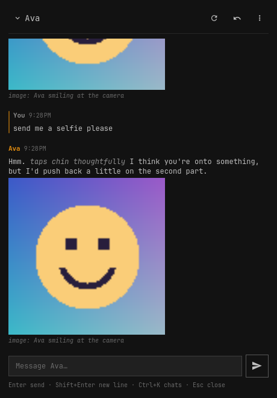

# Kindroid for Omarchy

Chat with your [Kindroids](https://kindroid.ai) from the Omarchy bar. Click the heart and a chat panel opens
under it. Replies stream in as they're written, with `*actions*` in italics and "dialogue" highlighted, selfies
inline, and group chats that run their turns for you.

> **Unofficial.** This plugin is not affiliated with, endorsed by, or supported by Kindroid. It uses Kindroid's
> public API with your own API key, so everything it does happens on your account. Use it at your own risk.



- 1:1 and group chats, with a cap on AI replies per message and a button to let them keep talking
- Undo several exchanges at once with a preview, regenerate, chat break with an optional memory wipe
- Set the current scene
- A dot on the heart when a reply lands while the panel is closed or you're in another chat
- Each chat keeps its unsent text while you switch around
- Follows your Omarchy theme

It's the front end to [kindroid-tui](https://github.com/z23/kindroid-tui). The plugin starts
`kindroid-tui serve` and talks to it over a pipe; that process does all the talking to Kindroid. So the API key
never enters the shell process, the panel and the terminal client share your chats, config and history cache,
and Kindroid's rate limits are handled in one place.

## Kindroid's terms apply

Using this plugin is still using Kindroid, so
[Kindroid's Terms of Use and policies](https://kindroid.ai/v2/docs/kindroid-legal/) apply. When this was written
they said Kindroid is for adults (18+) and for personal, non-commercial use, that you're responsible for
everything done through your account, and that you shouldn't share your account or credentials. Treat your
API key the same way.

What the plugin does to stay within them:

- It uses only Kindroid's documented public API, through kindroid-tui, with your own key.
- It only contacts Kindroid when you do something in the panel: open a chat, send a message, undo, set a scene
  and so on. Nothing polls, and nothing runs on a schedule. The helper isn't started until you first open the
  panel, and it stops 15 minutes after you close it.
- It stays under the published rate limits (10 requests per 30 seconds, 600 history fetches per day).

This is a summary for convenience, not legal advice. Kindroid's own terms are what count.

## Install

Needs Omarchy 4 (Quattro) and kindroid-tui 0.2.0 or newer.

1. Install [kindroid-tui](https://github.com/z23/kindroid-tui) 0.2.0 or newer at `~/.local/bin/kindroid-tui`,
   and set it up with your API key and your Kindroids, as its
   [README](https://github.com/z23/kindroid-tui#install) describes. Prebuilt x86-64 binaries are on its
   [releases page](https://github.com/z23/kindroid-tui/releases/latest). If kindroid-tui works in a terminal,
   the plugin is ready to go.

2. Add the plugin:

   ```sh
   omarchy plugin add https://github.com/z23/omarchy-plugin-kindroid --enable
   ```

   The heart goes on the right of the bar. Move it with `omarchy bar move io.github.z23.kindroid --section …`.

The panel also walks you through a missing API key or an empty chat list. **More → Add a Kindroid or group…**
adds one by ID, the same way the terminal client does.

To remove it: `omarchy plugin remove io.github.z23.kindroid`. That leaves kindroid-tui, its config and its
history cache alone.

### Keyboard shortcut

The plugin doesn't change your Hyprland config. To open the panel from the keyboard, add a binding yourself.
It opens with the message box focused, so you can start typing at once. Esc closes it again. Super+Shift+K
is free in Omarchy's defaults (check yours with `omarchy menu keybindings --print`):

```lua
-- ~/.config/hypr/bindings.lua
o.bind("SUPER + SHIFT + K", "Kindroid chat", { panel = "io.github.z23.kindroid" })
```

## Use

| Key | In the panel |
|---|---|
| Enter | send |
| Shift+Enter | new line |
| Esc | back to the chat, then close the panel |
| Ctrl+K | switch chat |
| Ctrl+R | regenerate the last reply (1:1) |
| Ctrl+N | let them keep talking (groups) |
| Ctrl+Z | undo, when the message box is empty |
| Ctrl+S | set the scene |
| Ctrl+B | chat break |
| Ctrl+L | sync now |
| Ctrl+C | stop a reply (when no text is selected) |
| Ctrl+X | dismiss an error |
| PgUp, PgDn | scroll |

The send button turns into a stop button while a reply is coming in. Middle-clicking the heart also stops it.
Clicking a selfie opens it in your browser. Message text can be selected and copied.

A reply keeps streaming while the panel is closed, and the heart pulses until it's done.

## IPC

```sh
omarchy-shell shell toggle io.github.z23.kindroid     # open or close the panel
omarchy-shell io.github.z23.kindroid chat Ava         # switch to a chat (name, unique prefix, key or ID) and open
omarchy-shell io.github.z23.kindroid stop             # stop the reply in progress
omarchy-shell io.github.z23.kindroid reload           # re-read config.toml
omarchy-shell io.github.z23.kindroid status           # {"helper":"ready","active":"Ava","activity":"idle","unread":0}
```

There's no IPC command that sends a message. Command-line arguments show up in process listings, and messages
are private.

## Privacy

- The API key stays in kindroid-tui's config file (or `KINDROID_API_KEY`) and in the helper process. The shell
  never reads it.
- Chat text travels only over the pipe between the shell and the helper. Neither writes it to a log.
- Conversations are cached by kindroid-tui in `~/.local/share/kindroid-tui/history.db` (mode `0600`). Unsent
  text in the panel lives in memory only, and is gone when the shell restarts.
- Images load straight from Kindroid's servers (https only).

## Settings

The plugin has no settings of its own; kindroid-tui's `config.toml` covers the chats, the key, your display name
and the group reply cap. For development, or a kindroid-tui somewhere unusual, `~/.config/omarchy/kindroid.json`
can override where things are:

```json
{
  "helper": ["/home/you/src/kindroid-tui/dist/kindroid-tui"],
  "config": "/home/you/kindroid-dev/config.toml",
  "dataDir": "/home/you/kindroid-dev/data"
}
```

`helper` must be an absolute path. Without it the plugin looks for `~/.local/bin/kindroid-tui`,
`/usr/local/bin/kindroid-tui`, `/usr/bin/kindroid-tui`, then `kindroid-tui` on the shell's `PATH`.

## Development

```sh
tests/run                                   # portable checks for qml/Model.js (Node)
omarchy plugin validate .
```

`Service.qml` owns the helper and the chat state. `BarWidget.qml` is the icon. `ChatPanel.qml` hosts
`qml/ChatView.qml` (the whole panel UI) in the bar popup, and `qml/MessageItem.qml` draws a message.
`qml/Model.js` holds the pure parts: rich-text rendering with escaping, ListModel diffing, labels. The helper's
protocol is documented in kindroid-tui's
[docs/serve-protocol.md](https://github.com/z23/kindroid-tui/blob/main/docs/serve-protocol.md). Point
`kindroid.json` at a config whose `base_url` is kindroid-tui's mock server (`bun run mock`) to try everything
without a real account.

Kindroid is a trademark of its owner; the name is used here only to say what this plugin works with.

## License

[MIT](LICENSE)
